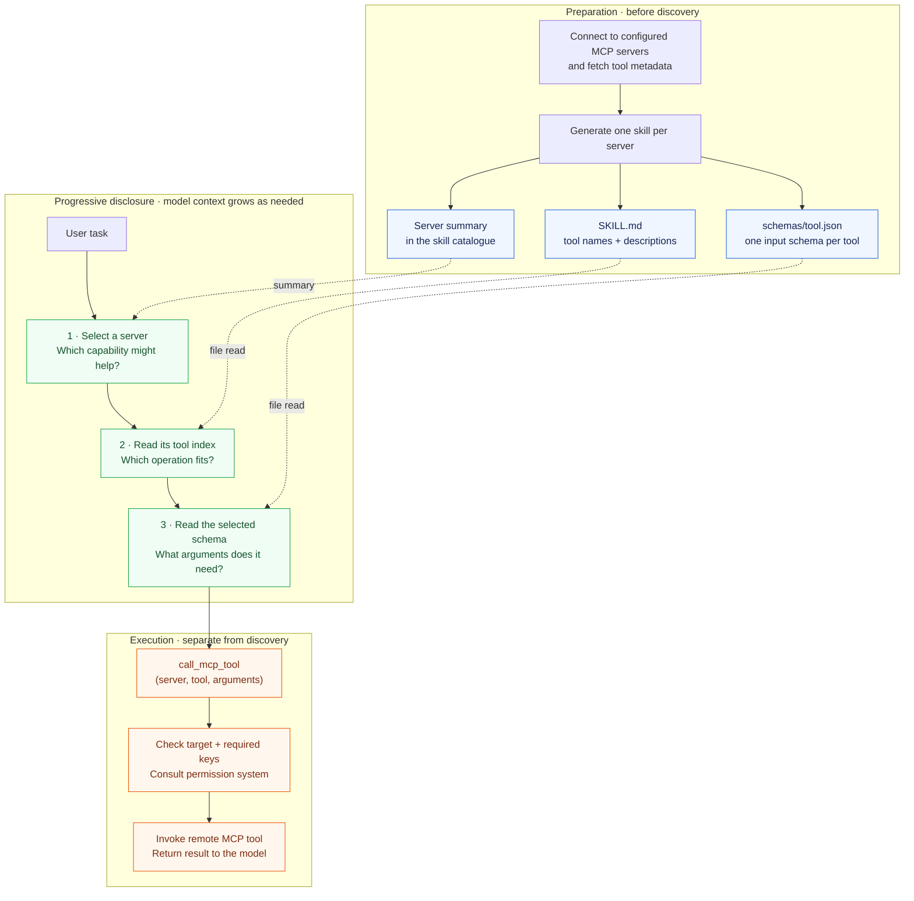

# Progressive Disclosure for MCP - A Skill-Driven Approach in Keen Code

<p class="blog-post-date">October 21, 2026</p>

Hello there good people! Today I want to share an architectural decision I made while building [Keen Code](https://github.com/mochow13/keen-code), my terminal-based coding agent written in Go.

The topic is MCP integration.

At first glance, integrating an MCP server looks straightforward. Connect to the server, fetch its tools, hand those tools to the language model, and let the model call them. Job done, right?

Well, not quite.

A single MCP server may expose dozens or even hundreds of tools. Each tool comes with a name, a description, and a JSON schema. Connect a few large servers, and suddenly the model receives thousands of tokens of tool definitions before the user has asked for anything.

I wanted to avoid loading those definitions eagerly. Keen Code already had a skills system, so I wondered: could MCP use the same discovery path?

That led to a skill-driven approach. Instead of exposing every MCP tool directly to the model, Keen Code represents each MCP server as a generated **Agent Skill**. The model discovers the server through the skills catalogue, reads its tool list when needed, reads a selected schema, and invokes the remote tool through one generic dispatcher.

In this article, I want to walk through that design as an alternative way to implement **progressive disclosure**: reveal enough information to make the next decision, rather than loading every detail upfront. This is not an argument that files are better than tool search. It is a look at where discovery can live, what this implementation makes straightforward, and what it still needs to handle.

So without further ado, let's dive right in!

## What problem was I trying to solve?

Imagine that we connect Keen Code to three MCP servers:

- GitHub with 40 tools
- an observability platform with 120 tools
- an internal developer platform with 300 tools

The simplest implementation would register 460 native tools with the language model. Every tool definition would include its description and schema.

That creates a few practical problems:

1. **The initial context becomes expensive.** The model receives hundreds of schemas even when the user only wants to rename a local Go function.
2. **Tool selection becomes noisy.** The model must choose among many similarly named operations.
3. **The tool surface changes dynamically.** Provider adapters need to handle a large and potentially changing list of definitions.
4. **Discovery can become fragmented.** Keen already has skills; introducing another catalogue would add a second discovery experience unless I deliberately connected the two.
5. **The architecture becomes provider-sensitive.** Not every model provider offers the same support for deferred or dynamically loaded tools.

The popularity and usefulness of MCP cannot be denied. But attaching more tools should not make every unrelated coding request heavier.

That led me to one core principle:

> A tool schema should enter the model's working context only when the model has a reasonable chance of using that tool.

## Why did I model an MCP server as a skill?

Keen Code already had a skills system. Skills were discoverable, selectively enabled, stored as ordinary files, and loaded on demand.

An MCP server is also a collection of related capabilities. GitHub tools belong together. Observability tools belong together. Deployment tools belong together.

So the mapping felt natural:

```text
One MCP server = one generated Agent Skill
```

For a server named `github`, Keen generates this directory:

```text
~/.keen/skills/mcp:github/
├── SKILL.md
├── .keen-generated-mcp.json
└── schemas/
    ├── create_issue.json
    ├── get_issue.json
    └── list_issues.json
```

The generated `SKILL.md` contains:

- the skill name, such as `mcp:github`
- a short description of the server
- instructions for calling MCP tools
- a table of exact tool names and descriptions

Each tool's input schema lives in a separate JSON file.

This creates three levels of information:

1. **Skill catalogue entry** — enough to identify the relevant server.
2. **Server tool index** — enough to identify the relevant tool.
3. **Selected tool schema** — enough to construct the call correctly.

Instead of loading everything at once, Keen progressively reveals detail.

## How does the architecture work?

Let's separate preparation from what the model sees during a task. Solid arrows show the flow; dashed arrows show where generated information is loaded. This diagram follows a live invocation, omitting result-cache lookups.



Let's go through this carefully.

### 1. Keen connects to configured MCP servers

The user configures servers in `~/.keen/mcp/configs.json`. Keen starts its MCP manager, connects to each server, and requests the live tool list.

At this point, Keen knows the name, description, and input schema of every exposed tool. But it does **not** register each one as a separate model-facing tool.

That distinction is the foundation of the design.

### 2. Keen generates an ordinary skill

For every connected server, Keen creates a skill named:

```text
mcp:<server>
```

For example:

```text
mcp:github
mcp:context7
mcp:posthog
```

Because these are ordinary skills, they participate in Keen's existing discovery lifecycle. They can appear in `/skills list`, be enabled or disabled in the catalogue, and be loaded through the same mechanism as a hand-written skill.

One important distinction: disabling the skill hides its catalogue entry. It does **not** stop an already-running MCP session or prevent a model that knows the target from calling it. Discovery visibility is not execution authorisation.

The integration does not create a parallel universe inside the agent. It extends an abstraction that already exists.

### 3. The system prompt receives only a compact catalogue entry

The model initially sees something similar to this:

```text
- mcp:github: Work with GitHub repositories, issues, and pull requests.
  → read ~/.keen/skills/mcp:github/SKILL.md
```

It does not receive all GitHub schemas.

If the user asks Keen to refactor a local package, the GitHub integration costs little more than that one catalogue line. If the user asks Keen to create an issue, the model has a clear path to more information.

### 4. The model reads the server's tool index

The generated `SKILL.md` may contain a table like this:

```markdown
| Tool name | Description |
|---|---|
| create_issue | Create a new issue in a repository |
| get_issue | Get an issue by number |
| list_issues | List repository issues |
```

The model now chooses an exact tool name.

Keen has delayed the detailed MCP context until the server became relevant. The model can now use the listed names and descriptions to choose an operation.

There are practical limits here. The generated table currently includes at most 1,000 tools and truncates long descriptions. Tools beyond that limit still have schema files, but no descriptive table entries. File-read limits can also require multiple reads to see the whole index. This is a readable discovery mechanism, not an unlimited catalogue search.

### 5. The model reads one schema

Before calling `create_issue`, the model reads:

```text
~/.keen/skills/mcp:github/schemas/create_issue.json
```

A simplified schema could look like this:

```json
{
  "type": "object",
  "properties": {
    "owner": { "type": "string" },
    "repo": { "type": "string" },
    "title": { "type": "string" },
    "body": { "type": "string" }
  },
  "required": ["owner", "repo", "title"]
}
```

At this point, the selected input contract is available as text in the model's working context. It is not registered as a native tool schema with the model provider.

### 6. One generic tool dispatches every MCP call

Keen exposes one built-in model tool called `call_mcp_tool`.

The model calls it like this:

```json
{
  "server": "github",
  "tool": "create_issue",
  "arguments": {
    "owner": "mochow13",
    "repo": "keen-code",
    "title": "Improve MCP skill refresh",
    "body": "Refresh generated MCP skills when the tool list changes."
  }
}
```

For a live invocation, Keen validates the server and exact tool name, checks the presence of required top-level argument keys, consults its permission system, and delegates to the MCP runtime.

Those checks are not full JSON Schema validation. Also, consulting the permission system does not mean displaying a new confirmation for every call: an existing session approval can satisfy it. We will return to both limitations below.

No matter how many MCP tools are connected, the model-facing execution surface stays stable:

```text
call_mcp_tool(server, tool, arguments)
```

Pretty simple, right?

## What does progressive disclosure look like here?

The central idea is a small sequence:

```text
server summary → tool index → selected schema → invocation → result
```

Each stage answers a different question:

1. **Which server might help?** The initial skill catalogue contains a short entry and a path to more detail.
2. **Which operation should I use?** The generated `SKILL.md` lists tool names and descriptions, within the limits described above.
3. **How do I call it?** A separate JSON file contains the selected tool's input schema.
4. **Can the operation run?** The dispatcher and runtime handle target checks, permissions, and execution.

The first three stages are discovery. The fourth is execution. Keeping those concepts separate matters: reading a file is not an approval, and hiding a catalogue entry is not a security control.

> Progressive disclosure organises what the model sees. Authorisation controls what the agent may do.

For a local refactoring task, most of this MCP information never needs to enter the model's context. For a task involving GitHub, the model has a path to the relevant details without receiving every other server's schemas first.

That is the useful property. It does not require a claim that this is the cheapest discovery strategy for every workload.

## Why use files and skills for this?

For Keen, the appeal was mostly architectural fit.

### 1. The model-facing execution interface stays stable

Provider adapters expose one generic MCP dispatcher:

```text
call_mcp_tool(server, tool, arguments)
```

They do not need to register each remote operation as a separate native tool. Discovery uses ordinary file reads, which Keen already supports.

This keeps the mechanism independent of a particular provider's deferred-tool API. Provider adapters still need to support Keen's normal tool loop, of course. There is no magic portability switch hiding in `SKILL.md`.

### 2. MCP reuses the existing discovery experience

Users can manage catalogue visibility with familiar commands:

```text
/skills list
/skills disable mcp:github
/skills enable mcp:github
```

This gives optional capabilities a consistent entry point. But, as noted earlier, these commands manage discovery visibility, not permission to execute remote operations.

### 3. Discovery artifacts are inspectable

The server index and schemas exist as ordinary files. A user can inspect them, compare generated versions, or follow the file reads that led to a tool call.

That makes the discovery path easier to examine. It does not guarantee that the model chose correctly, or prove that it read every instruction. Keen does not enforce a prerequisite-read check before dispatch.

### 4. Workflow guidance can sit alongside discovery

A schema explains an operation's input. A hand-written skill can explain a workflow. For a deployment workflow, that might mean checking the current release, inspecting failed stages before retrying, and seeking confirmation before a production change.

The current MCP generator writes tool metadata and calling instructions, not that domain-specific judgement. It also replaces the generated directory during regeneration. Manually editing the generated `SKILL.md` is therefore not a durable customisation mechanism.

For now, I would keep workflow guidance in a separate hand-written skill. A future overlay or generator extension could connect the two more explicitly.

This is a useful composition of skills and MCP, not a capability exclusive to Keen.

## How does this relate to tool search?

Tool search addresses the same broad problem: avoid putting every available schema into the initial model context.

It is worth separating two related things:

- **Claude Code's MCP Tool Search experience** lets Claude discover MCP tools on demand rather than eagerly loading all their definitions. Its documentation also describes how MCP server instructions help Claude decide when to search.
- **Anthropic's Tool Search API** provides deferred tool definitions and `tool_reference` expansion. Its documentation describes hosted search variants as well as custom client-side search.

The API's options should not all be treated as implementation details of Claude Code. In particular, retrieval does not have to happen inside the provider: a client can perform search and return tool references for expansion.

At a high level, a search-based path can look like this:

```text
search deferred catalogue → load selected native definitions → invoke a tool
```

Keen's current path looks like this:

```text
select server skill → read tool index → read selected schema → invoke dispatcher
```

Both disclose information progressively. They differ in how candidates are found and how the selected operation is presented to the model.

With native deferred definitions, selected tools become callable using their actual input schemas. In Keen, the model reads the selected schema as text, then constructs an `arguments` object inside a generic call. That is an extra translation step.

Search can also find candidates without first choosing a server. Server-first discovery instead depends on useful catalogue descriptions and manageable server indexes. If a server exposes hundreds of overlapping tools, scanning its index can become awkward.

There is no architectural rule that search must load five schemas while skill discovery loads one. The hosted Tool Search API documents a default of up to five results, with a configurable limit that can be one. Keen may also need to inspect multiple schemas before choosing an operation.

Nor are workflow guidance, inspectability, or centralised permissions exclusive to either approach. Claude Code supports skills and MCP server instructions. An agent exposing native tool definitions can still route every invocation through a common permission and execution layer.

The distinction I care about is narrower: **Keen implements discovery through its existing skill and filesystem abstractions, without requiring provider-native deferred-schema support.**

## What are the costs of server-first discovery?

The most obvious cost is extra agent-loop work. A first invocation commonly involves reading a skill, reading a schema, and then dispatching the call. More reads can mean more latency and more opportunities for the model to take a wrong turn.

Those reads provide an inspectable trace. They are not additional safety gates. A deployment is not safer simply because its schema arrived through two file reads rather than one search result.

There are a few other costs worth making explicit:

1. **Choosing the server is itself a retrieval problem.** If its summary is vague, the model may never open the right skill. Without a supplied description, the generated summary can be little more than the server's name.
2. **An index grows with the server.** Even without schemas, many names and descriptions can consume substantial context. Generation and file-read limits also affect coverage.
3. **Text schemas require careful argument construction.** The provider sees a generic dispatcher contract, not the selected operation's full native schema.
4. **Discovery context may need to be read again.** Repeated reads have a cost, and their usefulness depends on what history the agent retains and what files have actually been refreshed.

So I would not claim a token or latency win without measurements. A useful evaluation would include the catalogue entry, index reads, schema reads, tool-result envelopes, model round trips, caching, and repeated use across turns—not just the size of one schema.

Small, clearly grouped servers and a single enormous server are very different workloads. Architecture is annoyingly contextual like that.

## Could this approach grow into a hybrid?

Absolutely. Filesystem-backed discovery and ranked retrieval do not have to compete.

A future version could:

1. Keep a compact server catalogue and inspectable generated schemas.
2. Add local search across tool names, descriptions, and argument metadata.
3. Return a small candidate set rather than reading a large server table.
4. Load the selected schema as text, or expose it natively when a provider adapter supports that.
5. Keep execution permissions independent of how the tool was discovered.
6. Store durable workflow guidance outside replaceable generated directories.

That would retain the existing skill entry point while adding another way to navigate large catalogues.

## Concluding remarks

Building MCP support for Keen Code made me separate two questions: how does an agent connect to a capability, and how does the model learn enough to use it?

Keen's current answer to the second question is skill-driven progressive disclosure. Start with a compact server entry. Read its tool index when relevant. Read a selected schema. Invoke the operation through a stable dispatcher.

This is an alternative to search-led discovery, not an argument against it. Native deferred tools, client-side retrieval, generated skill files, and hand-written workflow guidance can all be parts of the same system.

The lesson I am taking from this is simple:

> Progressive disclosure is a design space, not a single tool-loading feature.

For Keen, reusing skills was a practical starting point. It kept discovery close to an abstraction the agent already understood, while leaving room to add other ways of navigating tools as the catalogue grows.

Hope you had fun reading. If you are building an agent, I would love to hear where you put the boundary between discovering a capability and executing it.

## References

- [Keen Code on GitHub](https://github.com/mochow13/keen-code)
- [Model Context Protocol](https://modelcontextprotocol.io/)
- [Anthropic: Tool Search Tool](https://platform.claude.com/docs/en/agents-and-tools/tool-use/tool-search-tool)
- [Claude Code: Scale with MCP Tool Search](https://code.claude.com/docs/en/mcp#scale-with-mcp-tool-search)
