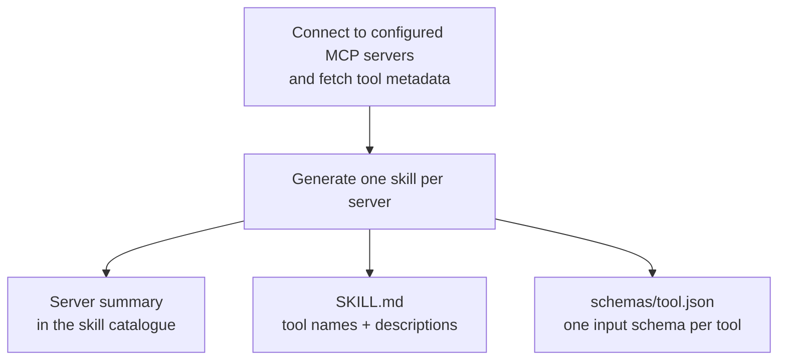
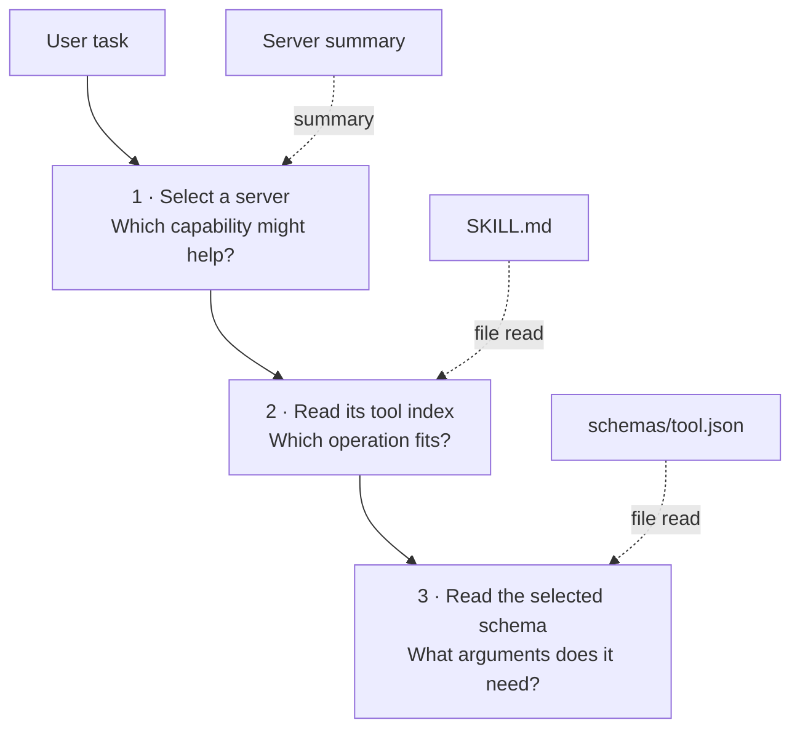
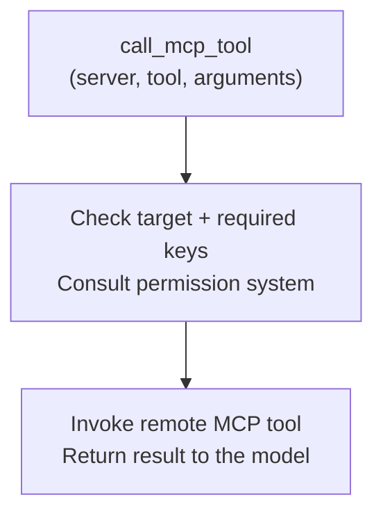

# Progressive Disclosure for MCP - A Skill-Driven Approach in Keen Code

<p class="blog-post-date">October 21, 2026</p>

While building [Keen Code](https://github.com/mochow13/keen-code), my terminal-based coding agent written in Go, I chose to integrate MCP tools through its existing skills system.

A basic MCP integration connects to a server, fetches its tools, and makes their definitions available to the language model. A server may expose dozens or hundreds of tools, each with a name, description, and JSON schema. Connecting several servers can add thousands of tokens of definitions to the model's initial context.

I wanted to avoid loading those definitions eagerly. Keen Code already had a skills system, so I wondered: could MCP use the same discovery path?

That led to a skill-driven approach. Instead of exposing every MCP tool directly to the model, Keen Code represents each MCP server as a generated **Agent Skill**. The model discovers the server through the skills catalogue, reads its tool list when needed, reads a selected schema, and invokes the remote tool through one generic dispatcher.

This article describes that design and its trade-offs. It uses **progressive disclosure**: loading enough information for the next decision rather than every detail upfront.

## What problem was I trying to solve?

Imagine that we connect Keen Code to three MCP servers:

- GitHub with 40 tools
- an observability platform with 120 tools
- an internal developer platform with 300 tools

The simplest implementation would register 460 native tools with the language model. Every tool definition would include its description and schema.

That creates a few practical problems:

1. **Initial context usage.** The model receives hundreds of schemas even for tasks that do not need them.
2. **Tool selection.** Many similarly named operations can make selection harder.
3. **Changing tool definitions.** Provider adapters need to handle a potentially large and changing list.
4. **Separate discovery paths.** Keen already has skills; a separate MCP catalogue would introduce another way to discover capabilities.
5. **Provider differences.** Support for deferred or dynamically loaded tools varies between model providers.

The goal was to load a tool's schema when it becomes relevant to the task, rather than at the start of every conversation.

## Why did I model an MCP server as a skill?

Keen Code already had a skills system. Skills were discoverable, selectively enabled, stored as ordinary files, and loaded on demand.

An MCP server groups related capabilities, which makes it a reasonable unit for a skill:

```text
One MCP server = one generated Agent Skill
```

For a server named `github`, Keen generates this directory:

```text
~/.keen/skills/mcp:github/
├── SKILL.md
├── .keen-generated-mcp.json
└── schemas/
    ├── create_issue.json
    ├── get_issue.json
    └── list_issues.json
```

The generated `SKILL.md` contains:

- the skill name, such as `mcp:github`
- a short description of the server
- instructions for calling MCP tools
- a table of exact tool names and descriptions

Each tool's input schema lives in a separate JSON file.

This creates three levels of information:

1. **Skill catalogue entry** — enough to identify the relevant server.
2. **Server tool index** — enough to identify the relevant tool.
3. **Selected tool schema** — enough to construct the call correctly.

Instead of loading everything at once, Keen progressively reveals detail.

## How does the architecture work?

The diagrams separate preparation, discovery, and execution. Solid arrows show the flow; dashed arrows show where generated information is loaded. They follow a live invocation, omitting result-cache lookups.

**Preparation · before discovery**



**Progressive disclosure · model context grows as needed**



**Execution · separate from discovery**



### 1. Keen connects to configured MCP servers

The user configures servers in `~/.keen/mcp/configs.json`. Keen starts its MCP manager, connects to each server, and requests the live tool list.

At this point, Keen knows the name, description, and input schema of every exposed tool, but does not register each one as a separate model-facing tool.

### 2. Keen generates an ordinary skill

For every connected server, Keen creates a skill named:

```text
mcp:<server>
```

For example:

```text
mcp:github
mcp:context7
mcp:posthog
```

Because these are ordinary skills, they participate in Keen's existing discovery lifecycle. They can appear in `/skills list`, be enabled or disabled in the catalogue, and be loaded through the same mechanism as a hand-written skill.

One important distinction: disabling the skill hides its catalogue entry. It does **not** stop an already-running MCP session or prevent a model that knows the target from calling it. Discovery visibility is not execution authorisation.

This reuses the existing skill lifecycle rather than introducing a separate discovery mechanism.

### 3. The system prompt receives only a compact catalogue entry

The model initially sees something similar to this:

```text
- mcp:github: Work with GitHub repositories, issues, and pull requests.
  → read ~/.keen/skills/mcp:github/SKILL.md
```

It does not receive all GitHub schemas.

If the user asks Keen to refactor a local package, the GitHub integration costs little more than that one catalogue line. If the user asks Keen to create an issue, the model has a clear path to more information.

### 4. The model reads the server's tool index

The generated `SKILL.md` may contain a table like this:

```markdown
| Tool name | Description |
|---|---|
| create_issue | Create a new issue in a repository |
| get_issue | Get an issue by number |
| list_issues | List repository issues |
```

The model now chooses an exact tool name.

Keen has delayed the detailed MCP context until the server became relevant. The model can now use the listed names and descriptions to choose an operation.

There are practical limits here. The generated table currently includes at most 1,000 tools and truncates long descriptions. Tools beyond that limit still have schema files, but no descriptive table entries. File-read limits can also require multiple reads to see the whole index. This is a readable discovery mechanism, not an unlimited catalogue search.

### 5. The model reads one schema

Before calling `create_issue`, the model reads:

```text
~/.keen/skills/mcp:github/schemas/create_issue.json
```

A simplified schema could look like this:

```json
{
  "type": "object",
  "properties": {
    "owner": { "type": "string" },
    "repo": { "type": "string" },
    "title": { "type": "string" },
    "body": { "type": "string" }
  },
  "required": ["owner", "repo", "title"]
}
```

At this point, the selected input contract is available as text in the model's working context. It is not registered as a native tool schema with the model provider.

### 6. One generic tool dispatches every MCP call

Keen exposes one built-in model tool called `call_mcp_tool`.

The model calls it like this:

```json
{
  "server": "github",
  "tool": "create_issue",
  "arguments": {
    "owner": "mochow13",
    "repo": "keen-code",
    "title": "Improve MCP skill refresh",
    "body": "Refresh generated MCP skills when the tool list changes."
  }
}
```

For a live invocation, Keen validates the server and exact tool name, checks the presence of required top-level argument keys, consults its permission system, and delegates to the MCP runtime.

Those checks are not full JSON Schema validation. Also, consulting the permission system does not mean displaying a new confirmation for every call: an existing session approval can satisfy it. We will return to both limitations below.

The model-facing MCP execution interface remains the same as servers and tools are added:

```text
call_mcp_tool(server, tool, arguments)
```

## What does progressive disclosure look like here?

The central idea is a small sequence:

```text
server summary → tool index → selected schema → invocation → result
```

Each stage answers a different question:

1. **Which server might help?** The initial skill catalogue contains a short entry and a path to more detail.
2. **Which operation should I use?** The generated `SKILL.md` lists tool names and descriptions, within the limits described above.
3. **How do I call it?** A separate JSON file contains the selected tool's input schema.
4. **Can the operation run?** The dispatcher and runtime handle target checks, permissions, and execution.

The first three stages are discovery; the fourth is execution. Reading a file does not grant approval, and hiding a catalogue entry does not prevent execution.

For a local refactoring task, most of this MCP information never needs to enter the model's context. For a task involving GitHub, the model has a path to the relevant details without receiving every other server's schemas first.

Whether this reduces overall cost depends on the workload.

## Why use files and skills for this?

For Keen, the appeal was mostly architectural fit.

### 1. The model-facing execution interface stays stable

Provider adapters expose one generic MCP dispatcher:

```text
call_mcp_tool(server, tool, arguments)
```

They do not need to register each remote operation as a separate native tool. Discovery uses ordinary file reads, which Keen already supports.

This avoids a dependency on a particular provider's deferred-tool API. Provider adapters still need to support Keen's normal tool loop.

### 2. MCP reuses the existing discovery experience

Users can manage catalogue visibility with familiar commands:

```text
/skills list
/skills disable mcp:github
/skills enable mcp:github
```

This gives optional capabilities a consistent entry point. But, as noted earlier, these commands manage discovery visibility, not permission to execute remote operations.

### 3. Discovery artifacts are inspectable

The server index and schemas exist as ordinary files. A user can inspect them, compare generated versions, or follow the file reads that led to a tool call.

That makes the discovery path easier to examine. It does not guarantee that the model chose correctly, or prove that it read every instruction. Keen does not enforce a prerequisite-read check before dispatch.

### 4. Workflow guidance can sit alongside discovery

A schema explains an operation's input. A hand-written skill can explain a workflow. For a deployment workflow, that might mean checking the current release, inspecting failed stages before retrying, and seeking confirmation before a production change.

The current MCP generator writes tool metadata and calling instructions, not that domain-specific judgement. It also replaces the generated directory during regeneration. Manually editing the generated `SKILL.md` is therefore not a durable customisation mechanism.

For now, I would keep workflow guidance in a separate hand-written skill. A future overlay or generator extension could connect the two more explicitly.

## How does this relate to tool search?

Tool search addresses the same broad problem: avoid putting every available schema into the initial model context.

It is worth separating two related things:

- **Claude Code's MCP Tool Search experience** lets Claude discover MCP tools on demand rather than eagerly loading all their definitions. Its documentation also describes how MCP server instructions help Claude decide when to search.
- **Anthropic's Tool Search API** provides deferred tool definitions and `tool_reference` expansion. Its documentation describes hosted search variants as well as custom client-side search.

The API's options should not all be treated as implementation details of Claude Code. In particular, retrieval does not have to happen inside the provider: a client can perform search and return tool references for expansion.

At a high level, a search-based path can look like this:

```text
search deferred catalogue → load selected native definitions → invoke a tool
```

Keen's current path looks like this:

```text
select server skill → read tool index → read selected schema → invoke dispatcher
```

Both disclose information progressively. They differ in how candidates are found and how the selected operation is presented to the model.

With native deferred definitions, selected tools become callable using their actual input schemas. In Keen, the model reads the selected schema as text, then constructs an `arguments` object inside a generic call. That is an extra translation step.

Search can also find candidates without first choosing a server. Server-first discovery instead depends on useful catalogue descriptions and manageable server indexes. If a server exposes hundreds of overlapping tools, scanning its index can become awkward.

The number of schemas loaded depends on the implementation and task. The hosted Tool Search API documents a default of up to five results, with a configurable limit that can be one. Keen may also need to inspect multiple schemas before choosing an operation.

Both approaches can support workflow guidance, inspectability, and centralised permissions. Claude Code supports skills and MCP server instructions, and native tool invocations can also pass through a common permission and execution layer.

Keen's implementation uses its existing skill and filesystem abstractions for discovery, without requiring provider-native deferred-schema support.

## What are the costs of server-first discovery?

A first invocation commonly involves reading a skill, reading a schema, and then dispatching the call. These additional steps can increase latency and create more opportunities for selection or argument errors. The reads provide a trace of discovery, but are not additional safety checks.

There are a few other costs worth making explicit:

1. **Choosing the server is itself a retrieval problem.** If its summary is vague, the model may never open the right skill. Without a supplied description, the generated summary can be little more than the server's name.
2. **An index grows with the server.** Even without schemas, many names and descriptions can consume substantial context. Generation and file-read limits also affect coverage.
3. **Text schemas require careful argument construction.** The provider sees a generic dispatcher contract, not the selected operation's full native schema.
4. **Discovery context may need to be read again.** Repeated reads have a cost, and their usefulness depends on what history the agent retains and what files have actually been refreshed.

Token and latency comparisons would need measurements covering catalogue entries, index and schema reads, tool-result envelopes, model round trips, caching, and repeated use across turns. Results would also depend on whether tools are spread across small, clearly grouped servers or concentrated in one large server.

## Could this approach grow into a hybrid?

Filesystem-backed discovery could also be combined with ranked retrieval.

A future version could:

1. Keep a compact server catalogue and inspectable generated schemas.
2. Add local search across tool names, descriptions, and argument metadata.
3. Return a small candidate set rather than reading a large server table.
4. Load the selected schema as text, or expose it natively when a provider adapter supports that.
5. Keep execution permissions independent of how the tool was discovered.
6. Store durable workflow guidance outside replaceable generated directories.

That would retain the existing skill entry point while adding another way to navigate large catalogues.

## Concluding remarks

Keen Code uses generated skills to make MCP tools available on demand. The model starts with a compact server entry, reads the tool index and selected schema when needed, and invokes the operation through a generic dispatcher.

Reusing skills kept discovery within an existing part of the agent. The trade-offs include additional file reads, server-first selection, and constructing arguments from schemas presented as text rather than native tool definitions. Search or provider-native deferred tools could complement this approach as the catalogue grows.

## References

- [Keen Code on GitHub](https://github.com/mochow13/keen-code)
- [Model Context Protocol](https://modelcontextprotocol.io/)
- [Anthropic: Tool Search Tool](https://platform.claude.com/docs/en/agents-and-tools/tool-use/tool-search-tool)
- [Claude Code: Scale with MCP Tool Search](https://code.claude.com/docs/en/mcp#scale-with-mcp-tool-search)
